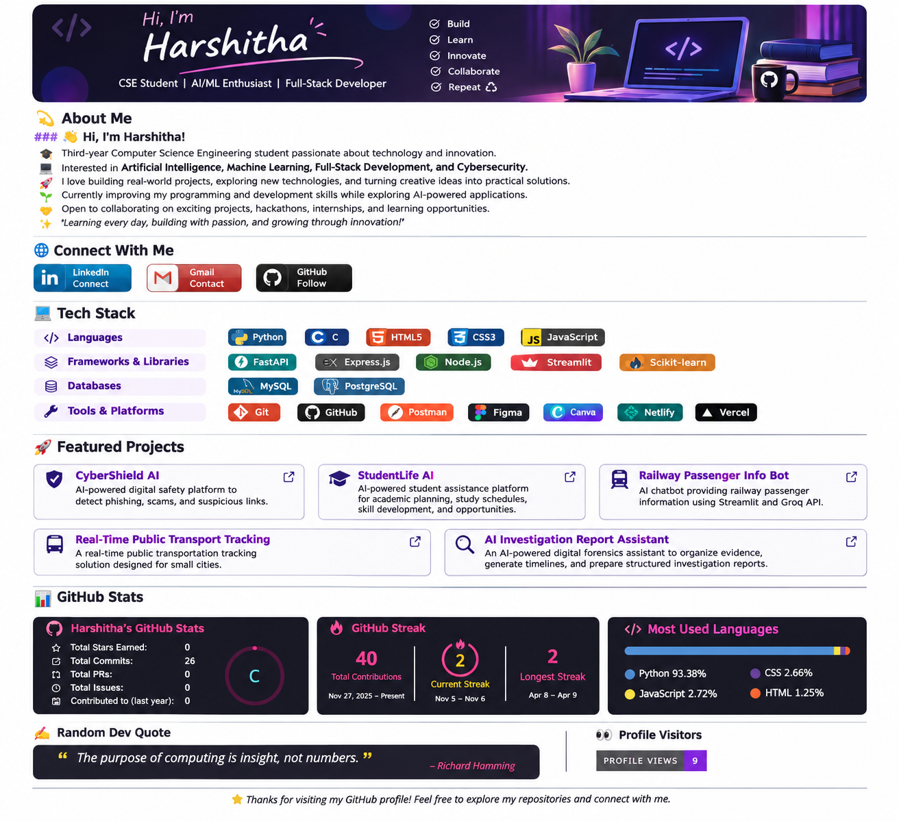

# 💫 About Me

### 👋 Hi, I'm Harshitha!

🎓 Third-year Computer Science Engineering student passionate about technology and innovation.

💻 Interested in **Artificial Intelligence, Machine Learning, Full-Stack Development, and Cybersecurity**.

🚀 I love building real-world projects, exploring new technologies, and turning creative ideas into practical solutions.

🌱 Currently improving my programming and development skills while exploring AI-powered applications.

🤝 Open to collaborating on exciting projects, hackathons, internships, and learning opportunities.

✨ *Learning every day, building with passion, and growing through innovation!*

---

# 🌐 Connect With Me

---

# 💻 Tech Stack

### Languages

### Frameworks & Libraries

### Databases

### Tools & Platforms

---

# 🚀 Featured Projects

### 🛡️ CyberShield AI
AI-powered digital safety platform designed to detect phishing, scams, suspicious messages, and malicious links.

### 🎓 StudentLife AI
AI-powered student assistance platform focused on academic planning, personalized study schedules, skill development, and opportunities.

### 🚆 Railway Passenger Information Bot
An AI-powered railway passenger information chatbot built using Streamlit and Groq API.

### 🚌 Real-Time Public Transport Tracking
A real-time public transportation tracking solution designed for small cities.

### 🤖 AI Investigation Report Assistant
An AI-powered digital forensics assistant that helps organize evidence, generate timelines, and prepare structured investigation reports.

---

# 📊 GitHub Stats

---

# 🏆 GitHub Trophies

---

### ✍️ Random Dev Quote

---

### 🔝 Top Contributed Repositories

---

### 👀 Profile Visitors

---

⭐ *Thanks for visiting my GitHub profile! Feel free to explore my repositories and connect with me.*

